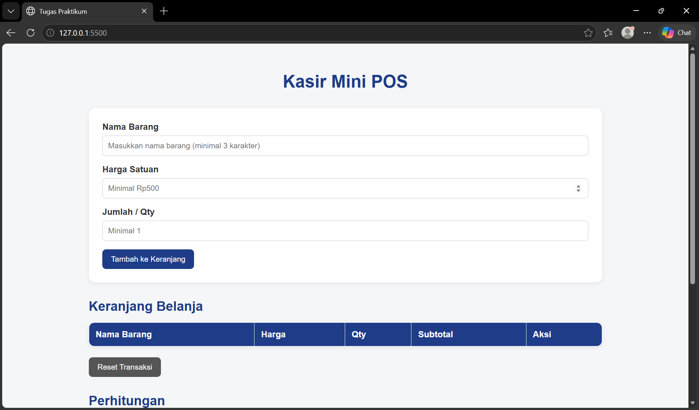
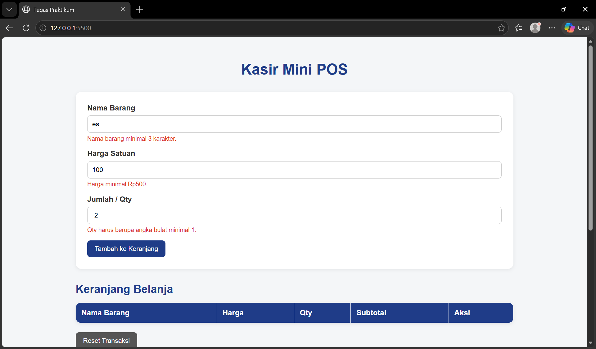
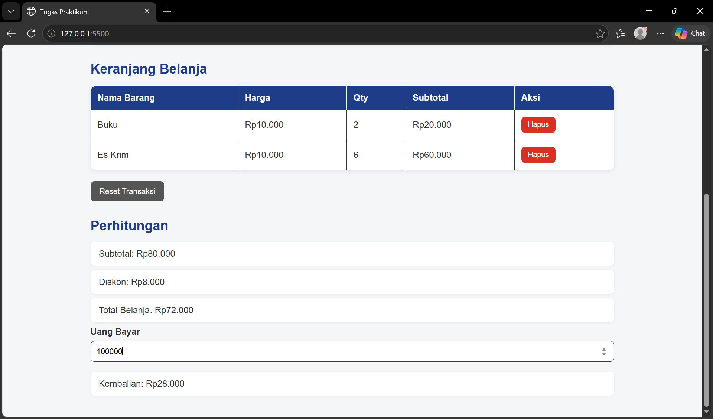

# Mini POS - Aplikasi Kasir Sederhana

## 1. Identitas

- Nama: Fadilla Andia Putri
- NIM: 124140136
- Kelas Praktikum: RB

## 2. Deskripsi Aplikasi

Mini POS merupakan aplikasi kasir sederhana berbasis web yang dibuat menggunakan HTML, CSS, dan JavaScript. Aplikasi ini digunakan untuk mencatat barang yang dibeli, menghitung subtotal, diskon, total belanja, serta kembalian dari pembayaran.

Tujuan pembuatan aplikasi ini adalah untuk menerapkan konsep dasar JavaScript seperti validasi form, event handler, array dan object, perhitungan menggunakan fungsi, serta penyimpanan data menggunakan `localStorage`.

Studi kasus yang digunakan adalah sistem kasir sederhana, di mana pengguna dapat memasukkan data barang, menyimpannya ke dalam keranjang belanja, menghapus barang, dan melakukan perhitungan pembayaran.

## 3. Panduan Menjalankan

1. Buka folder project Mini POS menggunakan Visual Studio Code.
2. Pastikan terdapat file:
   - `index.html`
   - `style.css`
   - `script.js`
   - `README.md`
3. Buka file `index.html`.
4. Klik kanan pada file `index.html`.
5. Pilih **Open with Live Server**.
6. Aplikasi akan terbuka secara otomatis di browser.
7. Masukkan nama barang, harga satuan, dan jumlah barang.
8. Klik Tambah ke Keranjang untuk memasukkan barang.
9. Masukkan uang pembayaran untuk melihat hasil kembalian.

## 4. Daftar Fitur

- [x] Input nama barang
- [x] Validasi nama barang minimal 3 karakter
- [x] Validasi harga minimal Rp500
- [x] Validasi jumlah barang berupa angka bulat minimal 1
- [x] Menampilkan pesan error pada input yang tidak valid
- [x] Menambahkan barang ke keranjang
- [x] Menampilkan daftar barang dalam tabel
- [x] Menghapus barang dari keranjang
- [x] Menghitung subtotal setiap barang
- [x] Menghitung subtotal seluruh barang
- [x] Memberikan diskon 10% jika subtotal mencapai Rp50.000
- [x] Menghitung total belanja setelah diskon
- [x] Menghitung uang pembayaran dan kembalian
- [x] Memberikan pesan jika uang pembayaran tidak mencukupi
- [x] Menyimpan data keranjang menggunakan `localStorage`
- [x] Memuat kembali data keranjang setelah halaman dibuka
- [x] Reset transaksi

## 5. Tangkapan Layar (Screenshot)

### A. Tampilan Form Input Utama

Menampilkan form untuk memasukkan nama barang, harga satuan, dan jumlah barang.

### B. Tampilan Validasi Error

Menampilkan pesan error ketika data yang dimasukkan tidak memenuhi ketentuan validasi.

### C. Tampilan Hasil Perhitungan dan Keranjang

Menampilkan daftar barang dalam keranjang serta hasil subtotal, diskon, total belanja, uang pembayaran, dan kembalian.

## 6. Penjelasan Teknis Singkat

### Validasi Input

Validasi dilakukan ketika form barang dikirim menggunakan `addEventListener("submit")`. Data nama, harga, dan jumlah barang diambil dari input menggunakan `getElementById()`.

Nama barang harus memiliki minimal 3 karakter, harga minimal Rp500, dan jumlah barang harus berupa angka bulat minimal 1. Jika terdapat input yang tidak sesuai, pesan error ditampilkan dan barang tidak dimasukkan ke dalam keranjang.

### Kalkulator Belanja

Subtotal setiap barang dihitung menggunakan rumus:

`subtotal = harga × qty`

Seluruh subtotal barang kemudian dijumlahkan untuk mendapatkan total subtotal keranjang. Jika subtotal mencapai Rp50.000 atau lebih, aplikasi memberikan diskon sebesar 10%.

Rumus total belanja:

`total = subtotal - diskon`

Setelah pengguna memasukkan uang pembayaran, aplikasi menghitung kembalian dengan rumus:

`kembalian = uang bayar - total belanja`

Jika uang pembayaran lebih kecil dari total belanja, aplikasi menampilkan pesan bahwa uang tidak mencukupi.

### localStorage

Data keranjang disimpan menggunakan `localStorage` agar data tidak langsung hilang ketika halaman di-refresh.

Data array keranjang diubah menjadi format JSON menggunakan:

`JSON.stringify(keranjang)`

Kemudian disimpan menggunakan:

`localStorage.setItem("keranjang", JSON.stringify(keranjang))`

Saat halaman dibuka kembali, data diambil dari `localStorage` dan diubah kembali menjadi array menggunakan:

`JSON.parse(localStorage.getItem("keranjang"))`

Dengan mekanisme tersebut, data barang yang sudah dimasukkan ke keranjang dapat tetap ditampilkan setelah halaman di-refresh.