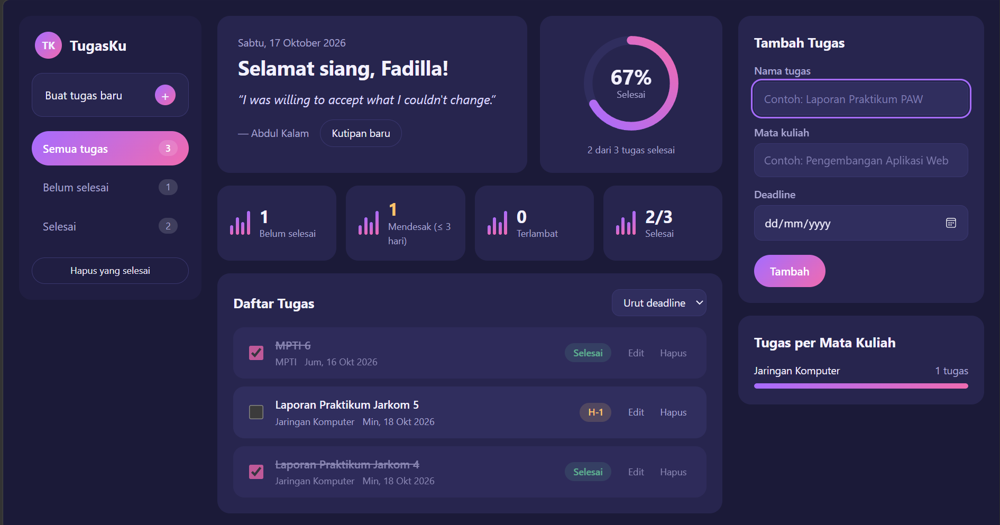

# Dashboard Tugas Kuliah
- **Nama:** Fadilla Andia Putri
- **NIM:** 124140136
- **Kelas:** RB

## Deskripsi Aplikasi

Dashboard Tugas Kuliah adalah aplikasi web sederhana untuk mencatat dan memantau tugas-tugas kuliah beserta deadline-nya, supaya tidak ada tugas yang terlewat. Setiap tugas otomatis diberi status berdasarkan sisa waktu (aman, segera, hari ini, atau terlambat), dan di bagian atas ada kutipan harian untuk menjaga semangat.

### Fitur

- **Tambah, edit, dan hapus tugas** (nama tugas, mata kuliah, deadline).
- **Tandai selesai** dengan checkbox, dan hapus semua tugas yang sudah selesai sekaligus.
- **Status deadline otomatis:** `H-n`, `Hari ini!`, atau `Terlambat n hari`, lengkap dengan warna badge.
- **Filter lewat sidebar** (Semua tugas / Belum selesai / Selesai, lengkap dengan jumlahnya) dan **urutan** (deadline / terbaru).
- **Ringkasan:** kartu statistik (belum selesai, mendesak ≤ 3 hari, terlambat, selesai), lingkaran progres persentase, dan jumlah tugas aktif per mata kuliah.
- **Kutipan harian** dari API publik [DummyJSON Quotes](https://dummyjson.com/quotes/random) memakai `async/await`. Kutipan disimpan per hari, bisa diganti lewat tombol "Kutipan baru", dan ada kutipan cadangan jika internet mati.
- **Data tersimpan di `localStorage`**, jadi tidak hilang saat halaman di-refresh.

## Screenshot

## Fitur ES6+ yang Diimplementasikan

| Fitur ES6+ | Lokasi (file : baris) |
|---|---|
| `let` dan `const` | `app.js:7-9`, `main.js:7`, `main.js:10-12` |
| Arrow function (lebih dari 3) | `utils.js:5`, `utils.js:11`, `app.js:94`, `app.js:101`, `app.js:106`, `main.js:15`, `main.js:42`, `main.js:62`, `main.js:124`, `main.js:177`, `main.js:248` |
| Template literals | `app.js:54`, `app.js:56`, `main.js:42-59`, `main.js:71-78`, `main.js:84-100`, `main.js:109-113`, `main.js:254-255` |
| Async / Await | `app.js:164-186` (`fetchQuote`), `main.js:248-257` (`loadQuote`) | 
| Class | `app.js:20` (`TaskItem`), `app.js:68` (`DashboardApp`) | 
| Getter dan static method | `app.js:39`, `app.js:50`, `app.js:60` | 
| Destructuring | `app.js:22-29` (parameter constructor), `app.js:85`, `app.js:150`, `app.js:176`, `main.js:42`, `main.js:71`, `main.js:83`, `main.js:104-109`, `main.js:166`, `main.js:208`, `main.js:252`, `utils.js:18` |
| Spread operator | `app.js:87`, `app.js:95`, `app.js:128`, `app.js:152-154`, `app.js:184`, `main.js:105` | 
| Default parameter | `app.js:22-29`, `app.js:120`, `app.js:164`, `app.js:190`, `utils.js:37`, `utils.js:46`, `main.js:71`, `main.js:248` | 
| Array methods modern | `app.js:94` (`map`), `app.js:101` (`find`), `app.js:106`, `app.js:121`, `app.js:142-144` (`filter`), `app.js:149-154` (`filter`, `reduce`, `find`, `map`), `main.js:105`, `main.js:109`, `main.js:129` (`map`), `main.js:143` (`some`) | 
| Modules (`import` / `export`) | `app.js:5`, `main.js:4-5`, `utils.js:5` | 
| `localStorage` | `app.js:74-81`, `utils.js:46-63` | 
