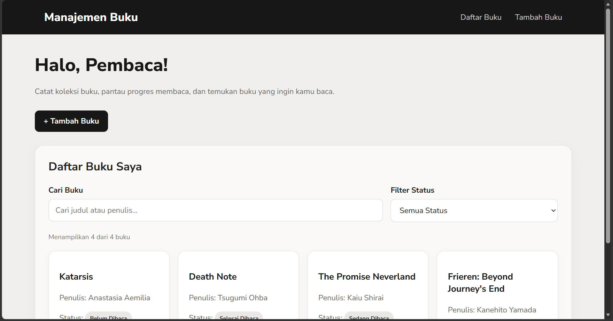
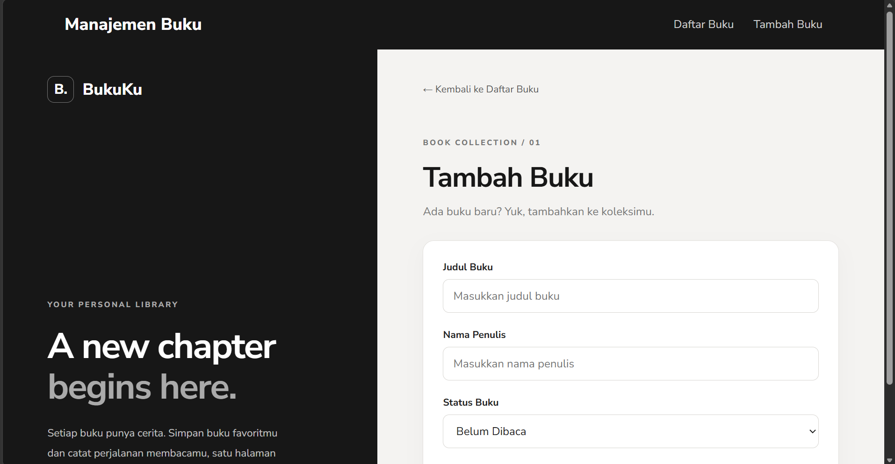
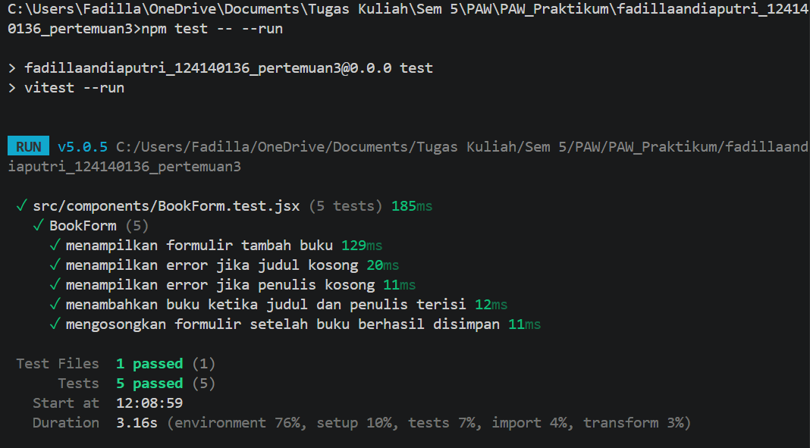

# Aplikasi Manajemen Buku Pribadi

## 1. Deskripsi Aplikasi

aplikasi web sederhana untuk mengelola koleksi buku pribadi. Aplikasi ini dibuat menggunakan React untuk membantu pengguna mencatat buku yang dimiliki, mengatur status membaca, serta mencari buku berdasarkan judul atau nama penulis.

Data buku disimpan menggunakan `localStorage`, sehingga data tetap tersimpan di browser meskipun halaman dimuat ulang.

## 2. Instalasi dan Cara Menjalankan Aplikasi

### Langkah Instalasi

1. Unduh atau clone repositori proyek dari GitHub.
2. Buka folder proyek melalui VS Code.
3. Buka terminal pada folder proyek.
4. Jalankan perintah berikut untuk memasang dependensi:

   ```bash
   npm install
   ```

5. Jalankan aplikasi menggunakan perintah:

   ```bash
   npm run dev
   ```

6. Buka alamat lokal yang ditampilkan pada terminal, biasanya `http://localhost:5173`.

### Menjalankan Unit Test

Untuk menjalankan pengujian secara langsung melalui terminal, gunakan perintah:

```bash
npm test -- --run
```

Perintah tersebut menjalankan unit test menggunakan Vitest dan menghentikan proses setelah pengujian selesai.

## 3. Screenshot Antarmuka Aplikasi

### Halaman Utama — Daftar Buku

Halaman utama menampilkan daftar koleksi buku. Pada halaman ini, pengguna dapat mencari buku, memfilter berdasarkan status membaca, serta mengedit atau menghapus buku yang tersedia.



### Halaman Tambah Buku

Halaman tambah buku menyediakan formulir untuk memasukkan judul buku, nama penulis, dan status membaca. Formulir juga dilengkapi validasi agar judul dan nama penulis wajib diisi sebelum buku disimpan.



## 4. Penjelasan Fitur React yang Digunakan

### a. Components

Komponen digunakan untuk membagi antarmuka menjadi bagian-bagian yang lebih kecil dan dapat digunakan kembali. Contohnya adalah `BookForm`, `BookCard`, dan `BookList`.

### b. useState

`useState` digunakan untuk menyimpan dan mengubah data yang berkaitan dengan tampilan, seperti isi formulir, kata kunci pencarian, dan filter status buku.

### c. useEffect

`useEffect` digunakan pada custom hook penyimpanan lokal untuk menyimpan perubahan data buku ke `localStorage`.

### d. Custom Hooks

Aplikasi menggunakan dua custom hook, yaitu:

- `useBooks`: Mengelola data buku, termasuk menambah, mengubah, menghapus, mencari, dan memfilter buku.
- `useLocalStorage`: Membantu membaca dan menyimpan data melalui `localStorage`.

Penggunaan custom hooks membantu memisahkan logika pengelolaan data dari komponen tampilan.

### e. Context API

Context API digunakan untuk membagikan data buku dan fungsi pengelolaannya ke komponen yang membutuhkan tanpa harus meneruskan props melalui banyak tingkat komponen.

### f. React Router DOM

React Router DOM digunakan untuk mengatur navigasi antara halaman daftar buku (`/`) dan halaman tambah buku (`/tambah-buku`).

### g. Props dan PropTypes

Props digunakan untuk mengirimkan data atau fungsi dari satu komponen ke komponen lain. PropTypes digunakan untuk memeriksa tipe props agar penggunaan komponen lebih terstruktur.

### h. Form Validation

Validasi dilakukan untuk memastikan judul buku dan nama penulis telah diisi. Jika salah satu kolom kosong, aplikasi menampilkan pesan kesalahan kepada pengguna.

## 5. Laporan Pengujian (Unit Testing)

