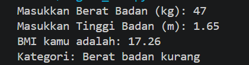
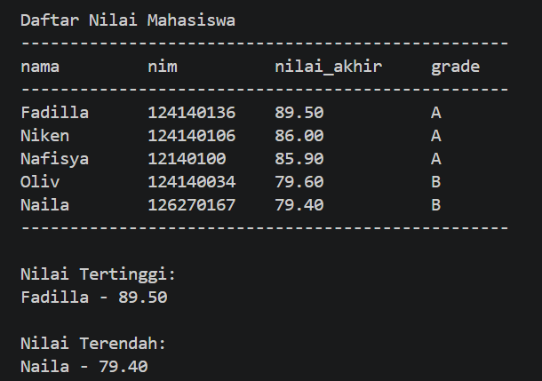
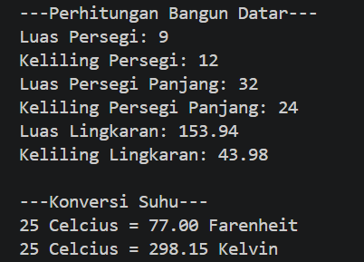

## Identitas Mahasiswa

- **Nama:** Fadilla Andia Putri
- **NIM:** 124140136

### Soal 1 - Program Menghitung BMI

Program ini digunakan untuk menghitung Body Mass Index (BMI) berdasarkan berat badan dan tinggi badan pengguna.

Alur kerja program:
1. Pengguna memasukkan berat badan dalam kilogram dan tinggi badan dalam meter.
2. Program menghitung BMI menggunakan rumus berat badan dibagi tinggi badan kuadrat.
3. Program menentukan kategori BMI menggunakan percabangan `if`, `elif`, dan `else`.
4. Program menampilkan hasil BMI dengan dua angka di belakang koma beserta kategorinya.

**Screenshot hasil eksekusi:**



### Soal 2 - Pengelolaan Data Nilai Mahasiswa

Program ini digunakan untuk mengelola nilai beberapa mahasiswa menggunakan list dan dictionary.

Alur kerja program:
1. Menyimpan data minimal lima mahasiswa yang terdiri dari nama, NIM, nilai UTS, nilai UAS, dan nilai tugas.
2. Menghitung nilai akhir menggunakan bobot UTS 30%, UAS 40%, dan tugas 30%.
3. Menentukan grade mahasiswa berdasarkan nilai akhir.
4. Menampilkan data mahasiswa dalam bentuk tabel.
5. Mencari dan menampilkan mahasiswa dengan nilai tertinggi dan terendah.

**Screenshot hasil eksekusi:**



### Soal 3 - Modul Matematika Python & Program Penggunaannya

Program ini menggunakan module Python buatan sendiri untuk melakukan perhitungan matematika dan konversi suhu.

Alur kerja program:
1. Membuat module `math_operations.py` yang berisi konstanta PI dan beberapa fungsi matematika.
2. Menyediakan fungsi untuk menghitung luas dan keliling persegi, persegi panjang, serta lingkaran.
3. Menyediakan fungsi konversi suhu dari Celsius ke Fahrenheit dan Celsius ke Kelvin.
4. Mengimpor module dan fungsi yang diperlukan ke dalam `main.py`.
5. Memanggil seluruh fungsi dan menampilkan hasil perhitungannya di terminal.

**Screenshot hasil eksekusi:**



## Cara Menjalankan Program

Pastikan Python sudah terpasang di komputer. Program ini dibuat menggunakan Python 3.14.8.

Buka terminal pada folder praktikum, kemudian jalankan perintah berikut sesuai tugas:

**1. Menjalankan Program BMI**
```bash
python tugas1_bmi.py
```

**2. Menjalankan Program Manajemen Nilai Mahasiswa**
```bash
python tugas2_nilai_mahasiswa.py
```

**3. Menjalankan Program Python Math Module**
```bash
python main.py
``