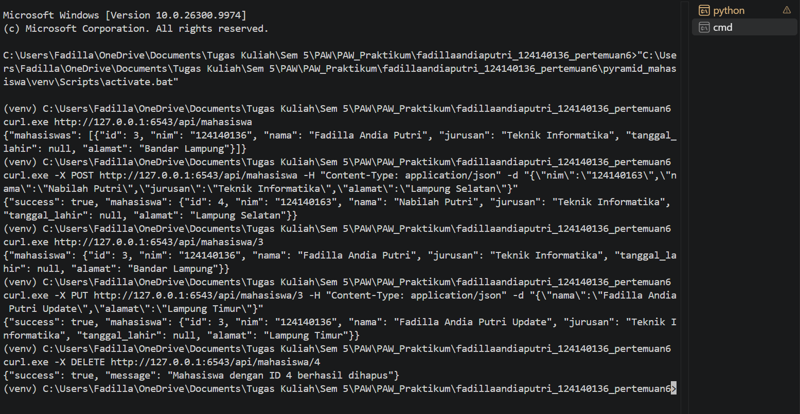
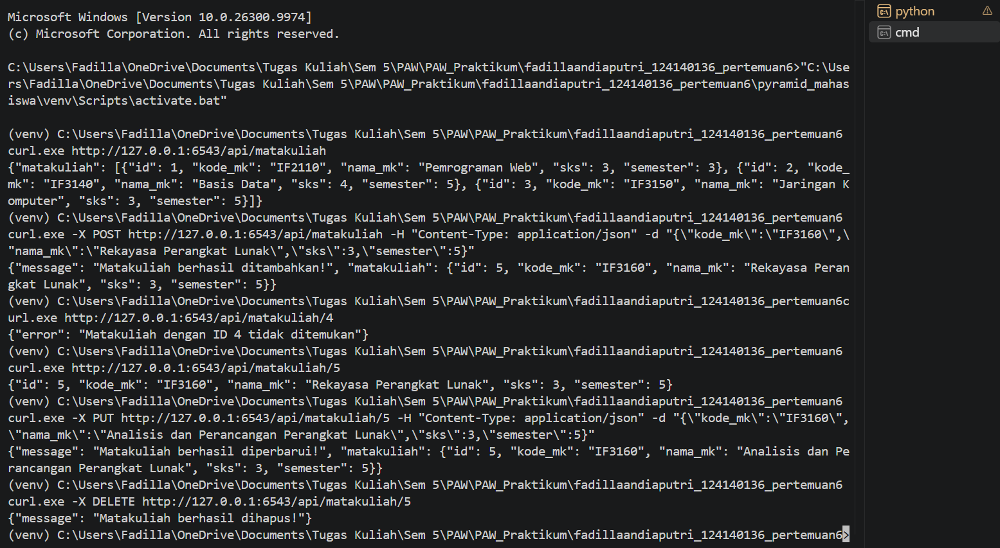

# Praktikum Pemrograman Web - Pertemuan 6

## Identitas

- **Nama:** Fadilla Andia Putri
- **NIM:** 124140136
- **Program Studi:** Teknik Informatika
- **Mata Kuliah:** Praktikum Pemrograman Web

## Deskripsi

Proyek ini merupakan implementasi REST API menggunakan framework Pyramid dan database PostgreSQL. Aplikasi menyediakan fitur CRUD (Create, Read, Update, Delete) untuk mengelola data mahasiswa dan data mata kuliah.

## Teknologi yang Digunakan

- Python
- Pyramid Framework
- SQLAlchemy
- PostgreSQL
- Alembic
- Waitress
- cURL untuk pengujian API

## Fitur

### 1. API Mahasiswa

Digunakan untuk mengelola data mahasiswa.

| Method | Endpoint | Fungsi |
|---|---|---|
| GET | `/api/mahasiswa` | Menampilkan seluruh mahasiswa |
| POST | `/api/mahasiswa` | Menambahkan mahasiswa |
| GET | `/api/mahasiswa/{id}` | Menampilkan detail mahasiswa |
| PUT | `/api/mahasiswa/{id}` | Mengubah data mahasiswa |
| DELETE | `/api/mahasiswa/{id}` | Menghapus mahasiswa |

### 2. API Matakuliah

Digunakan untuk mengelola data mata kuliah.

| Method | Endpoint | Fungsi |
|---|---|---|
| GET | `/api/matakuliah` | Menampilkan seluruh mata kuliah |
| POST | `/api/matakuliah` | Menambahkan mata kuliah |
| GET | `/api/matakuliah/{id}` | Menampilkan detail mata kuliah |
| PUT | `/api/matakuliah/{id}` | Mengubah data mata kuliah |
| DELETE | `/api/matakuliah/{id}` | Menghapus mata kuliah |

## Persiapan dan Instalasi

1. Pastikan Python, PostgreSQL, dan pip sudah terpasang.
2. Aktifkan virtual environment.
3. Install dependency yang dibutuhkan sesuai konfigurasi proyek.
4. Pastikan konfigurasi koneksi database pada `development.ini` sudah sesuai.

## Menjalankan Aplikasi

Masuk ke direktori proyek yang berisi file `development.ini`, kemudian jalankan:

```bash
python -m pyramid.scripts.pserve development.ini --reload
```

Aplikasi berjalan pada alamat:

```text
http://127.0.0.1:6543
```

## Pengujian API

Pengujian dilakukan menggunakan cURL melalui terminal.

Pengujian mencakup:
- GET untuk melihat data.
- POST untuk menambahkan data.
- PUT untuk mengubah data.
- DELETE untuk menghapus data.
- Pengujian validasi ketika data yang dikirim tidak lengkap.
- Pengujian ketika data dengan ID tertentu tidak ditemukan.

## Dokumentasi Pengujian

### 1. Pengujian CRUD Mahasiswa



### 2. Pengujian CRUD Matakuliah




